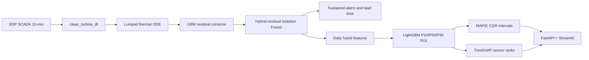
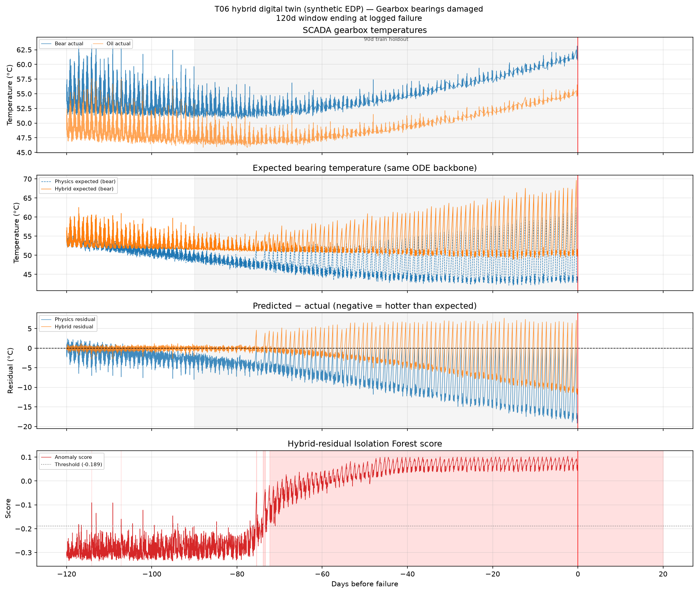
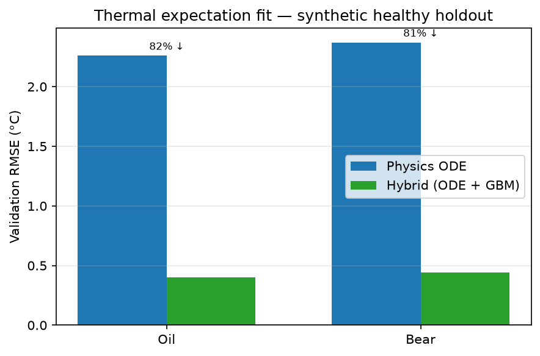
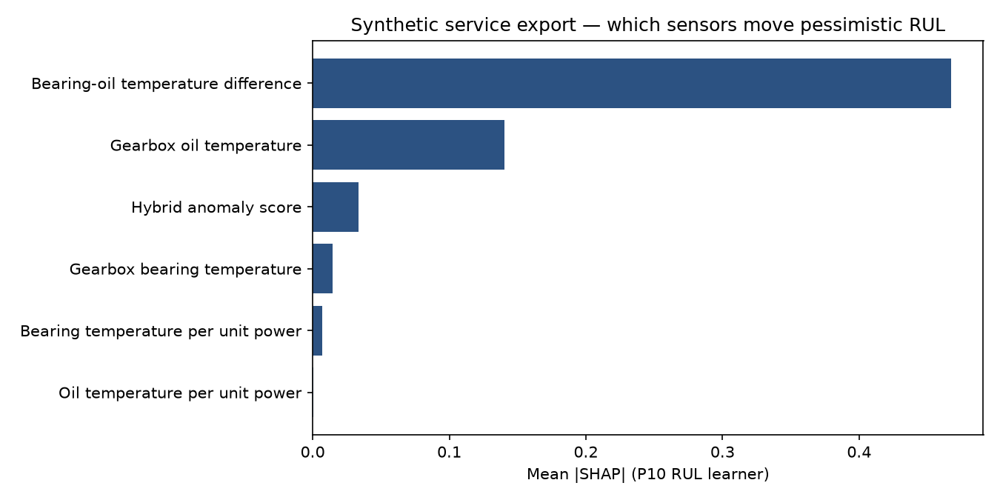
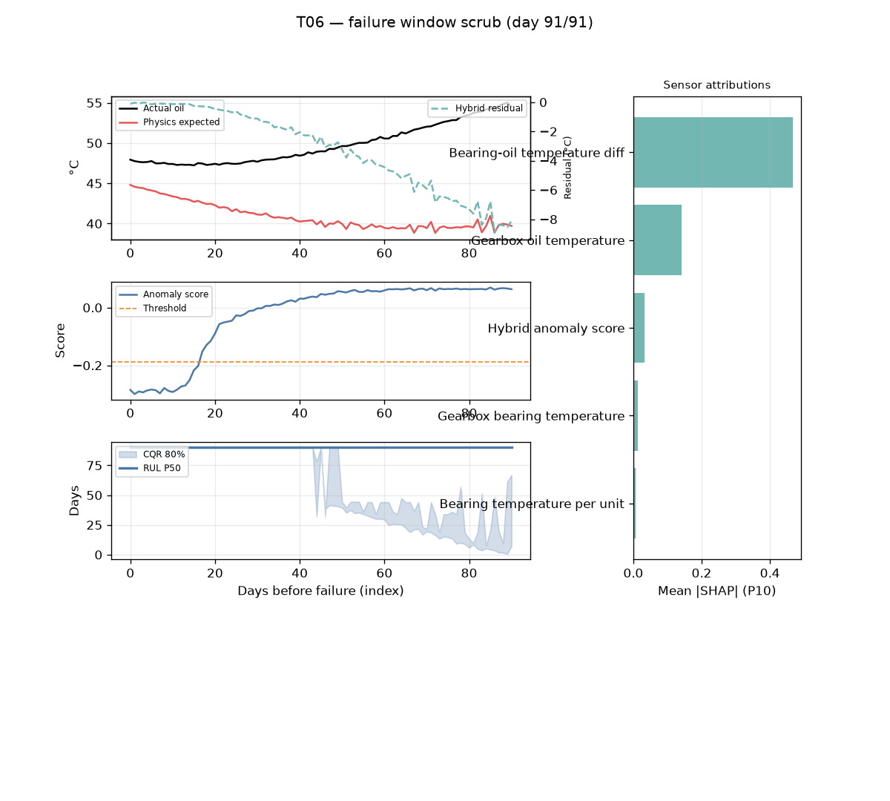
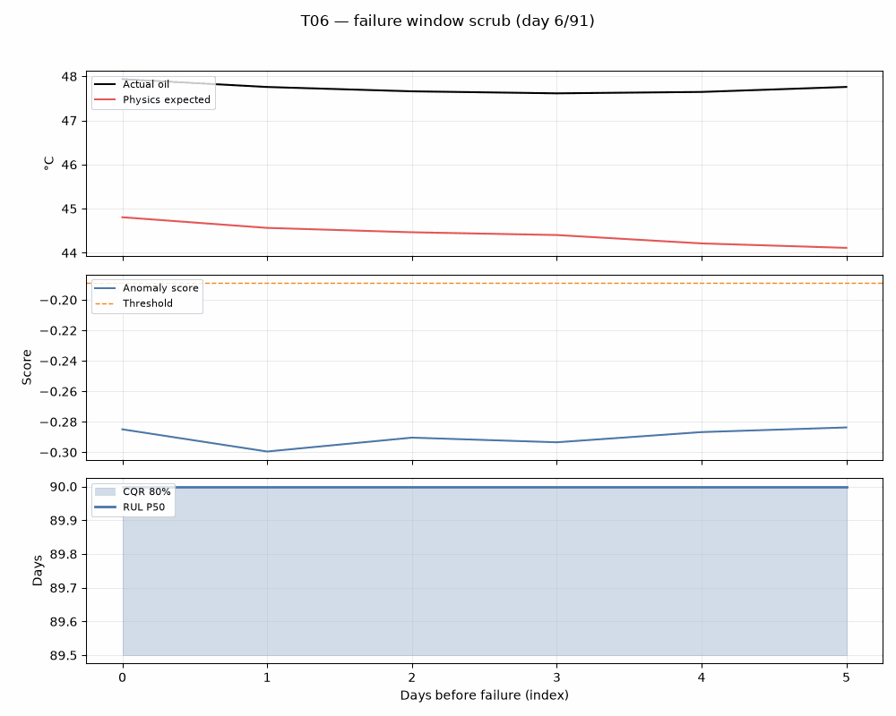

# wind-digital-twin

Hybrid **digital twin** capstone (**v1.0.0**) for a wind-turbine **gearbox/drivetrain thermal** path: EDP SCADA → lumped thermal ODE → **learned residual corrector** → **hybrid-residual anomaly detector** → **probabilistic gearbox RUL** (P10/P50/P90 + MAPIE conformal bands) → **TreeSHAP sensor explanations** → **FastAPI + Streamlit** serving. RUL training and LOFO evaluation live in [grid-gnn-faults-2](https://github.com/mehmetertac/grid-gnn-faults-2); this repo ships the Week 10 physics path and the deployment layer.

Full taxonomy, fidelity levels, and pipeline diagram: **[docs/ARCHITECTURE.md](docs/ARCHITECTURE.md)**.

## Quickstart

```powershell
python -m venv .venv
.\.venv\Scripts\Activate.ps1
pip install -e ".[dev]"
pre-commit install

# Optional: PINN heat toy (PyTorch; CI stays torch-free by default)
pip install -e ".[pinn]"
python scripts/run_pinn_heat.py

python scripts/generate_synthetic_edp.py --force
python scripts/download_edp.py --check
python scripts/run_gearbox_thermal.py
python scripts/run_learned_residual.py
python scripts/run_hybrid_anomaly.py --turbine T06
python scripts/run_twin_pass.py --turbine T06
pytest tests/ -q
```

Real EDP data: see [data/README.md](data/README.md) and `python scripts/download_edp.py --instructions`. Re-run `run_twin_pass.py --data-dir <path>` after download; figures label **real EDP** automatically.

## Architecture (shipped pipeline)



Week 10 scoring path: [`scripts/run_twin_pass.py`](scripts/run_twin_pass.py) → [`eval/twin_pass.py`](src/wind_digital_twin/eval/twin_pass.py). End-to-end RUL timeline (requires `pip install -e path/to/grid-gnn-faults-2`): [`scripts/run_twin.py`](https://github.com/mehmetertac/grid-gnn-faults-2/blob/main/scripts/run_twin.py) in grid-gnn-faults-2.

## End-to-end twin timeline (T06)

**Synthetic EDP** (default local data): four aligned panels around the logged gearbox-bearing failure — SCADA temperatures, physics vs hybrid **expected** bearing temperature (same ODE backbone), physics vs hybrid **residuals**, and hybrid-residual anomaly score with threshold and alarm spans. Gray band: 90-day training holdout before failure.



## Why physics-informed? (PINN ablation)

Week 10 guardrail: a 1-D heat equation \(u_t = \alpha u_{xx}\) on \([0,1]^2\) with sparse **initial and boundary** labels only (no interior sensors). A plain MLP fits those points; with **physics loss off** (`w_f=0`) it does not recover the true decay in the interior (relative L2 **~2.7×10⁻¹** vs analytical). The same architecture with a **PDE residual** at collocation points (`w_f=1`) matches the analytical solution (**~2.7×10⁻³** relative L2).


That pattern is what we want on SCADA: sparse temperature observations plus a **thermal ODE/physics consistency** term, not interpolation between sensors. Code: [`src/wind_digital_twin/pinn/`](src/wind_digital_twin/pinn/), [`scripts/run_pinn_heat.py`](scripts/run_pinn_heat.py), notebook [`notebooks/pinn_heat_toy.ipynb`](notebooks/pinn_heat_toy.ipynb). Paper notes: [docs/reading_notes.md](docs/reading_notes.md).

## Hybrid vs physics-only (healthy validation)

On **healthy** rows only (time-ordered 80/20 split), the GBM corrector fits systematic ODE error from exogenous regime features — not gear temperatures. **Synthetic EDP** holdout RMSE (°C):

| Turbine | Oil physics | Oil hybrid | Oil Δ% | Bear physics | Bear hybrid | Bear Δ% |
|---------|-------------|------------|--------|--------------|-------------|---------|
| T01 | 2.08 | 0.50 | 76 | 2.15 | 0.55 | 75 |
| T06 | 2.26 | 0.40 | 82 | 2.37 | 0.44 | 81 |
| T07 | 2.58 | 0.40 | 84 | 2.68 | 0.44 | 83 |
| T11 | 2.74 | 0.42 | 85 | 2.80 | 0.46 | 84 |

Source: `results/residual/rmse_comparison.json` after `python scripts/run_twin_pass.py`.



Pre-failure **degradation** shows in the timeline residuals and anomaly score, not in this healthy RMSE chart.

## Gearbox RUL (probabilistic + conformal)

Daily aggregates of hybrid residuals, anomaly score, and θ features feed LightGBM quantiles at **P10/P50/P90**, widened with **MAPIE CQR** at 80%/90%. Evaluation is **leave-one-failure-out** on four catalogued EDP gearbox events (three turbines). Design: [grid-gnn-faults-2/docs/RUL_DESIGN.md](https://github.com/mehmetertac/grid-gnn-faults-2/blob/main/docs/RUL_DESIGN.md).

| Event | Turbine | LOFO MAE (P50) | Pinball q0.5 | Raw [P10,P90] coverage | CQR 80% coverage | P10 first below 14 d (days before failure) |
| --- | --- | --- | --- | --- | --- | --- |
| T01 pump damage | T01 | — | — | — | — | — |
| T06 bearing damage | T06 | — | — | — | — | — |
| T09 repair | T09 | — | — | — | — | — |
| T09 noise | T09 | — | — | — | — | — |

Em dashes until a fleet **scored CSV** is exported from this twin without refitting the ODE (`python scripts/run_twin.py` in grid-gnn-faults-2). **Coverage caveat:** split conformal guarantees are **marginal**; with four events, small calibration tails, and non-exchangeable run-to-failure windows, gaps versus 80%/90% are expected — not a tuning knob ([RUL_DESIGN.md](https://github.com/mehmetertac/grid-gnn-faults-2/blob/main/docs/RUL_DESIGN.md)).



The bar chart uses committed smoke weights in [`service/models/`](service/models/); re-run `service/scripts/export_models.py` after real EDP download for field-facing ranks.

## ODE surrogate speedup (demo)

Small NN surrogate for batched lumped-ODE trajectories ([`thermal_surrogate.py`](src/wind_digital_twin/surrogate/thermal_surrogate.py), notebook [`notebooks/thermal_surrogate.ipynb`](notebooks/thermal_surrogate.ipynb)). **Not** the SCADA scoring path — illustration only. Requires `pip install -e ".[pinn]"`.

| Metric | Value (local benchmark) |
|--------|-------------------------|
| ODE seconds / trajectory | ~1.46×10⁻³ |
| NN seconds / trajectory | ~2.43×10⁻⁶ |
| Speedup | **~600×** |

## What this tells an O&M planner (vs a SCADA alarm list)

A **SCADA alarm list** fires on fixed or fleet thresholds: “bearing temperature high.” That conflates **normal hot operation** at high load with **extra heat the operating point does not explain**.

This twin answers three questions:

1. **Expected behavior:** Given power, RPM, and nacelle temperature, what should oil/bearing temperature be (lumped thermal ODE)?
2. **Systematic model gap:** On past healthy operation, where does physics systematically miss (GBM on exogenous features only)?
3. **Degradation signal:** Is the **hybrid residual** persistently worse than on healthy history, with an Isolation Forest score above a threshold fit on a **healthy validation tail** (not the 90 days before failure)?

Outcome: a **sustained alarm with lead time in days** before logged gearbox failure — advisory for inspection planning, not turbine control.

## Deployment dashboard (Week 11)

Probabilistic gearbox RUL and the Week 10 scoring path are served from [`service/`](service/): FastAPI on **:8000**, Streamlit on **:8501**. Models in [`service/models/`](service/models/) are **synthetic smoke** weights (regenerate with `python service/scripts/export_models.py`).

```powershell
pip install -e ".[serve]"
pip install -r service/dashboard/requirements.txt
python service/scripts/export_models.py   # if models/ missing
$env:TWIN_MODELS_DIR = "service/models"
uvicorn twin_service.api.app:app --reload --port 8000
# separate terminal:
$env:API_URL = "http://127.0.0.1:8000"
streamlit run service/dashboard/app.py
```

Or `docker compose -f service/docker-compose.yml up --build`.

| Endpoint | Role |
| --- | --- |
| `POST /twin/score` | SCADA window → physics-expected oil temp, hybrid residual, anomaly score |
| `POST /twin/rul` | Daily features → P10/P50/P90, CQR band, top-five **P10** sensor attributions |
| `GET /twin/series` | Precomputed failure-window timeline for the dashboard scrubber |

Gearbox RUL training, LOFO conformal evaluation, and TreeSHAP live in [grid-gnn-faults-2](https://github.com/mehmetertac/grid-gnn-faults-2). Week 11 reflection: [WEEK_11_REFLECTION.md](https://github.com/mehmetertac/grid-gnn-faults-2/blob/main/WEEK_11_REFLECTION.md).





Regenerate PNG/GIF (residual + P10 SHAP bar): `python service/scripts/generate_dashboard_gif.py` after `python service/scripts/export_models.py`.

## Limitations (honest)

- **Few failure events** — four gearbox log lines on three turbines; RUL and conformal coverage are demonstration-grade, not fleet SLAs.
- **Marginal conformal coverage** — CQR intervals are honest on held-out windows but not a guarantee on the next turbine; say this before being asked.
- **No vibration / CMS** in EDP — thermal SCADA only; envelope and band energy often lead temperature by days to weeks on real gearboxes.
- **Single thermal failure mode** — one score on oil and HSS bearing temperature; not a classifier for pump vs bearing vs noise (T01/T06/T09 are different root causes in the log).
- **10-minute SCADA** — sub-hour transients are averaged; τ may pile at the floor when series are quasi-steady.
- **Open-loop ODE** — state resets on long gaps; sustained hot spells remain visible in residuals by design.
- **Figures in this README** use **synthetic EDP** unless you re-run `run_twin_pass.py` on a downloaded real dataset.

## Layer summary

- **Physics layer:** Lumped thermal ODE with time constant τ on healthy data.
- **Learned residual:** HGBM (optional LightGBM via `WIND_DT_USE_LIGHTGBM=1`) on healthy physics error.
- **Detector:** Isolation Forest on hybrid residual windows plus θ / bear–oil context; [`physics_hybrid`](src/wind_digital_twin/anomaly/physics_hybrid.py) remains the Week 6 physics-only baseline.
- **Evaluation:** Training excludes the **90 days before failure**; metrics are **time-ordered**.

Agent and contribution rules: [AGENT.md](AGENT.md). Current status: [handover.md](handover.md).

## License

Apache-2.0 — see [LICENSE](LICENSE).
